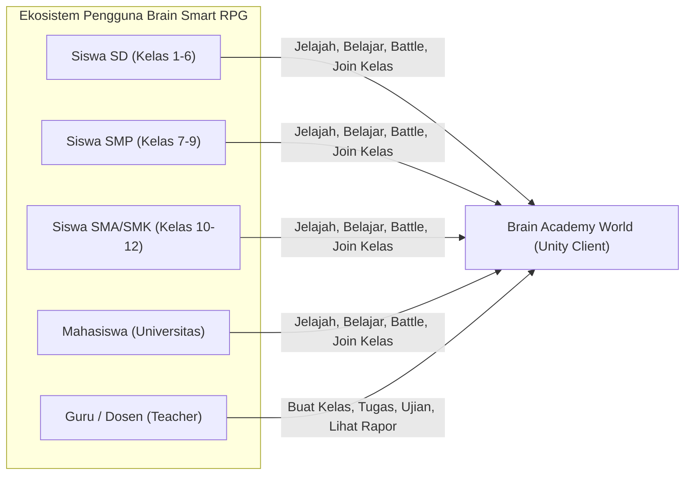
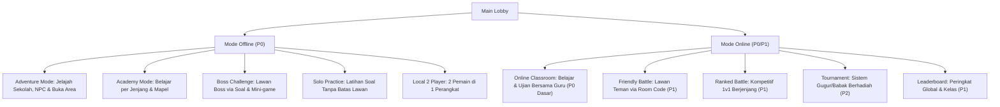
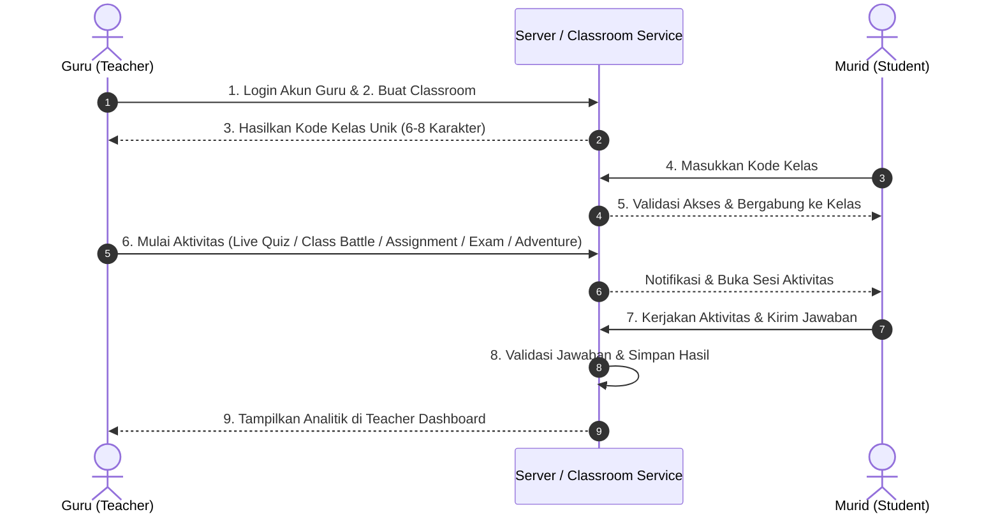
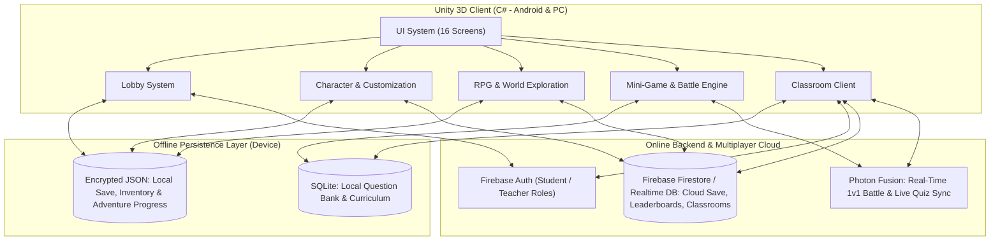

# PRODUCT REQUIREMENTS DOCUMENT (PRD)
# BRAIN SMART RPG — VERSION 3.0

| Atribut Dokumen | Detail |
| :--- | :--- |
| **Nama Produk** | Brain Smart RPG |
| **Versi Dokumen** | 3.0 (Berdasarkan GDD v3.0) |
| **Status** | Game Concept & Pre-Production |
| **Genre** | Educational RPG, School Life, Multiplayer, Quiz Battle |
| **Target Platform** | Android (Mobile/Tablet) & PC (Windows) |
| **Game Engine** | Unity (C#) — 3D Cartoon Stylized |
| **Mode Permainan** | Hybrid Offline & Online |
| **Tagline** | *"Learn Together, Play Together, Grow Together!"* |

---

## 1. RINGKASAN EKSEKUTIF & VISI PRODUK

### 1.1 Latar Belakang & Masalah
Pembelajaran konvensional dan aplikasi kuis dua dimensi sering kali terasa monoton bagi siswa, sementara game RPG komersial jarang memiliki kurikulum terstruktur maupun fitur pemantauan langsung untuk guru. **Brain Smart RPG** menjembatani kesenjangan tersebut dengan menyatukan eksplorasi dunia sekolah 3D, kompetisi mini-game edukasi cepat, dan **Classroom Mode (LMS terintegrasi)** dalam satu ekosistem.

### 1.2 Tiga Pilar Utama Produk
1. **RPG School Life:** Eksplorasi kehidupan sekolah dalam dunia 3D (*Brain Academy World*), kustomisasi karakter, interaksi NPC, dan penyelesaian misi (*quest*).
2. **Educational Gaming:** Materi lintas jenjang (SD, SMP, SMA, SMK, Universitas) yang disajikan melalui modul belajar interaktif, *Boss Challenge*, dan 10 jenis *mini-game*.
3. **Multiplayer Competition & Classroom:** Kompetisi *real-time* 1v1, *Local 2-Player*, turnamen, serta ruang kelas virtual di mana guru dapat mengelola tugas, ujian, dan *Live Quiz*.

### 1.3 Target Metrik Keberhasilan (Success Metrics / KPI)
| Kategori | Metrik (KPI) | Target MVP |
| :--- | :--- | :--- |
| **Engagement** | Rata-rata durasi sesi bermain harian (*Average Session Length*) | ≥ 20 menit / hari |
| **Learning Outcome** | Tingkat penyelesaian kuis/materi (*Quiz Completion Rate*) | ≥ 75% per sesi belajar |
| **Retention** | Retensi Pemain (D1 / D7 / D30) | D1 ≥ 45%, D7 ≥ 25%, D30 ≥ 12% |
| **Classroom Adoption** | Persentase kelas aktif mingguan yang dibuat oleh Guru | ≥ 60% kelas menyelesaikan ≥ 1 aktivitas/minggu |
| **Technical Stability** | *Crash-Free Sessions* & *Frame Rate* | ≥ 99.2% *crash-free*; stabil 30–60 FPS di perangkat target |

---

## 2. TARGET PENGGUNA & MATRIKS PERAN (USER PERSONAS & RBAC)

### 2.1 Hak Akses Berdasarkan Peran (Role-Based Access Control)
| Fitur / Modul | Siswa / Mahasiswa (Offline Guest) | Siswa / Mahasiswa (Online Account) | Guru / Tenaga Pendidik (Teacher Account) |
| :--- | :---: | :---: | :---: |
| Eksplorasi Dunia 3D & Kustomisasi Karakter | ✅ | ✅ | ✅ |
| Academy Mode (SD, SMP, SMA, SMK, Universitas) | ✅ | ✅ | ✅ |
| Offline Modes (Adventure, Solo, Boss, Local 2P) | ✅ | ✅ | ✅ |
| Online Battle (Ranked 1v1, Friendly, Tournament) | ❌ | ✅ | ✅ |
| Gabung Kelas via Kode & Kerjakan Tugas/Ujian | ❌ | ✅ | ❌ |
| Teacher Academy & Buat Kelas / Kode Kelas | ❌ | ❌ | ✅ |
| Buat Tugas, Kuis, Ujian & Akses Teacher Dashboard | ❌ | ❌ | ✅ |

> [!IMPORTANT]
> **Kebijakan Kurikulum Terbuka:** Pemilihan jenjang pendidikan (SD, SMP, SMA, SMK, Universitas) dapat diakses bebas sesuai kebutuhan belajar pemain dan **tidak dikunci (unlocked)** oleh level karakter RPG.

---

## 3. KEBUTUHAN FUNGSIONAL (FUNCTIONAL REQUIREMENTS)

Prioritas fitur dibagi menjadi:
- **P0 (MVP):** Wajib ada pada rilis versi pertama (Fase 1–8).
- **P1 (Early Online):** Dikembangkan segera setelah fondasi lokal & classroom dasar stabil (Fase 9).
- **P2 (Full Release & Live Ops):** Ekspansi konten penuh, turnamen besar, dan event musiman.

---

### 3.1 Sistem Karakter & Progresi RPG (`FR-CHAR`)
| ID | Kebutuhan Fungsional | Kriteria Penerimaan (Acceptance Criteria) | Prioritas |
| :--- | :--- | :--- | :---: |
| **FR-CHAR-01** | **Tipe Karakter** | Mendukung 7 tipe karakter 3D Cartoon Stylized: *Elementary Student, Junior High Student, Senior High Student, University Student, Teacher, Headmaster, School NPC*. (MVP: minimal 1 karakter murid & 1 karakter guru dapat dimainkan). | **P0** |
| **FR-CHAR-02** | **Kustomisasi Karakter** | Pemain dapat mengubah 10 atribut visual: Gender, Rambut, Wajah, Seragam, Sepatu, Tas, Aksesori, Emote, Animasi, dan Skin Karakter dengan *real-time 3D preview*. | **P0** (Dasar) **P2** (Penuh) |
| **FR-CHAR-03** | **Sistem EXP & Level** | Setiap penyelesaian quest, modul Academy, dan pertandingan memberikan EXP. Level meningkat mengikuti kurva progresif (misal: $\text{EXP}_{\text{next}} = 100 \times \text{Level}^{1.5}$) dan membuka *milestone reward* (Gold Coin/Badge). | **P0** |

---

### 3.2 Dunia Permainan & Eksplorasi 3D (`FR-WORLD`)
| ID | Kebutuhan Fungsional | Kriteria Penerimaan (Acceptance Criteria) | Prioritas |
| :--- | :--- | :--- | :---: |
| **FR-WORLD-01** | **Lokasi Brain Academy World** | Mencakup 13 lokasi: (1) *Main School Building*, (2) *Elementary School Area*, (3) *Junior High School Area*, (4) *Senior High School Area*, (5) *University Area*, (6) *Teacher Office*, (7) *Library*, (8) *Science Lab*, (9) *Computer Lab*, (10) *Cafeteria*, (11) *School Playground*, (12) *Sports Arena*, (13) *Competition Hall*. (MVP: 1 lingkungan sekolah utama terpadu). | **P0** (1 Area) **P2** (13 Area) |
| **FR-WORLD-02** | **Navigasi & Interaksi Karakter** | Kontrol berjalan dan berlari (*virtual joystick* di Android, `WASD` + Mouse di PC), sistem interaksi NPC (dialog & *quest giver*), perpindahan antar-ruangan (*portal/door trigger*), serta *social hub* untuk melihat pemain lain saat mode online. | **P0** |

---

### 3.3 Sistem Pendidikan & Kurikulum (`FR-EDU`)
| ID | Jenjang | Cakupan Kelas & Mata Pelajaran | Prioritas |
| :--- | :--- | :--- | :---: |
| **FR-EDU-01** | **SD (Elementary)** | Kelas 1–6: Matematika Dasar, Bahasa Indonesia, Pendidikan Pancasila, IPA, IPS, Bahasa Inggris Dasar, Seni & Budaya. | **P0** (5 Mapel Inti) |
| **FR-EDU-02** | **SMP (Junior High)** | Kelas 7–9: Matematika, Bahasa Indonesia, Bahasa Inggris, IPA, IPS, Pendidikan Pancasila, Informatika, Sejarah. | **P0** (5 Mapel Inti) |
| **FR-EDU-03** | **SMA (Senior High)** | Kelas 10–12: Matematika, Fisika, Kimia, Biologi, Ekonomi, Sejarah, Sosiologi, Geografi, Informatika, Bahasa Indonesia, Bahasa Inggris, Pendidikan Pancasila. | **P0** (5 Mapel Inti) |
| **FR-EDU-04** | **SMK (Vocational)** | Bidang Keahlian: Rekayasa Perangkat Lunak (RPL), Teknik Komputer & Jaringan (TKJ), Akuntansi, Bisnis, Desain, Teknik Otomotif. | **P2** |
| **FR-EDU-05** | **Universitas** | Program Studi: Teknologi Informasi, Pendidikan, Ekonomi, Sains, Bisnis, Komunikasi. | **P2** |
| **FR-EDU-06** | **Teacher Academy** | Ruang khusus bagi akun Guru untuk menyusun bank soal, mengatur modul pembelajaran, mengelola kelas, dan meninjau penilaian. | **P0** (Dasar) |

---

### 3.4 Sistem Main Lobby & Navigasi Utama (`FR-LOBBY`)
- **Elemen HUD Lobby (`FR-LOBBY-01` - P0):** Menampilkan *3D Character Display* interaktif di tengah layar, *Player Profile*, *Account Level*, *Gold Coin*, *Diamond*, *Badge*, *Competitive Rank*, *Quest Shortcut*, *Mail*, dan *Settings*.
- **10 Menu Navigasi Utama (`FR-LOBBY-02` - P0):**
  1. `Battle` — Masuk ke pemilihan mode tanding (Local 2P, Ranked, Friendly, Tournament).
  2. `Adventure` — Masuk ke eksplorasi dunia sekolah 3D & misi cerita.
  3. `Academy` — Pilih jenjang pendidikan & mata pelajaran untuk belajar mandiri.
  4. `Classroom` — Akses kelas virtual (murid: masukkan kode kelas; guru: kelola kelas).
  5. `Character` — Kustomisasi tampilan dan atribut visual karakter.
  6. `Inventory` — Kelola item yang dimiliki pemain.
  7. `Collection` — Lihat daftar *Badge*, *Title*, dan pencapaian.
  8. `Shop` — Akses *Gold Shop, Diamond Shop, Daily Shop, Event Shop*.
  9. `Ranking` — Lihat papan peringkat (*Leaderboard*) pemain dan kelas.
  10. `Quest` — Daftar *Daily Quest*, *Weekly Quest*, dan *Seasonal Event*.

---

### 3.5 Mode Permainan: Offline & Online (`FR-MODE`)

---

### 3.6 Sistem Mini-Game & Mekanisme Pertandingan (`FR-MINIGAME`)
1. **Daftar 10 Mini-Game:**
   - **MVP (P0 — Pilih 5):** *Quick Answer, Math Race, Memory Challenge, True or False, Word Battle*.
   - **Ekspansi (P2 — 5 Tambahan):** *History Quiz, Technology Challenge, Logic Puzzle, Science Challenge, Geography Challenge*.
2. **Aturan & Struktur Pertandingan (`FR-MINIGAME-01`):**
   - **Jumlah Pemain:** 2 Pemain (1v1 Online, 1v1 Local Shared-Screen, atau 1vAI pada mode latihan/Boss).
   - **Jumlah Ronde:** 5 Ronde per pertandingan.
   - **Durasi Menjawab:** 10–20 detik per soal/ronde (dilengkapi indikator *countdown timer* visual).
   - **Sumber Soal:** Acak lintas kategori atau difilter sesuai pilihan mata pelajaran & jenjang.
   - **Penentuan Pemenang:** Pemain dengan akumulasi skor tertinggi di akhir ronde ke-5. Jika seri (*draw*), diadakan 1 soal *Sudden Death* berdasarkan kecepatan menjawab.
3. **Rumus Perhitungan Skor (`FR-MINIGAME-02`):**

| Kondisi | Poin yang Diberikan | Keterangan |
| :--- | :---: | :--- |
| **Jawaban Benar** | `+100` | Diberikan kepada setiap pemain yang menjawab benar sebelum waktu habis. |
| **Bonus Jawaban Tercepat** | `+50` | Diberikan kepada pemain pertama yang mengunci jawaban benar pada soal tersebut. |
| **Perfect Round** | `+100` | Bonus tambahan di akhir ronde apabila pemain menjawab seluruh soal pada ronde tersebut dengan benar tanpa kesalahan. |
| **Jawaban Salah / Waktu Habis** | `0` | Tidak ada pengurangan poin (*no negative scoring*) agar ramah anak. |

---

### 3.7 Sistem Ranking Kompetitif (`FR-RANK` — P1)
- **Struktur Tier:** 6 tingkatan Rank, masing-masing terbagi atas **Tier III → Tier II → Tier I** (kecuali Mythic dapat menggunakan poin bintang):
  `Bronze` → `Silver` → `Gold` → `Platinum` → `Diamond` → `Mythic`.
- **Pemisahan Progresi:** Rank kompetitif sepenuhnya terpisah dari *Account Level* (EXP) dan *Education Progress* (Academy).
- **Validasi Server:** Perubahan poin rank hanya sah apabila pertandingan diselesaikan dan divalidasi oleh server untuk mencegah manipulasi di sisi klien.

---

### 3.8 Sistem Classroom & Teacher Dashboard (`FR-CLASS`)

- **5 Mode Aktivitas Classroom (`FR-CLASS-01`):**
  1. **Live Quiz (P0):** Kuis interaktif waktu-nyata yang dikendalikan langsung oleh guru dari layar utama.
  2. **Class Battle (P1):** Kompetisi antarkelompok/antarmurid di dalam satu kelas.
  3. **Assignment (P0):** Pekerjaan rumah / tugas mandiri dengan tenggat waktu (*deadline*).
  4. **Exam Mode (P1):** Mode ujian terkunci dengan batas waktu ketat, pengacakan soal, dan kalkulasi nilai otomatis.
  5. **Learning Adventure (P2):** Misi petualangan RPG kustom yang ditugaskan guru kepada murid.
- **Kebutuhan Teacher Dashboard (`FR-CLASS-02` - P0 Dasar, P1 Penuh):**
  Menampilkan metrik: Jumlah murid, Daftar murid, Mata pelajaran, Tugas aktif, Nilai per individu, Rata-rata kelas, *Progress* belajar, Riwayat aktivitas, dan *Ranking* kelas.

---

### 3.9 Sistem Mata Uang, Inventory & Shop (`FR-ECON`)

> [!CAUTION]
> **Kebijakan Anti Pay-to-Win (Fair Play Guarantee):**
> Baik **Gold Coin** maupun **Diamond** dilarang keras memberikan keuntungan akademik (seperti bocoran jawaban, tambahan waktu ujian) ataupun keunggulan kompetitif di *Ranked Battle*. Seluruh item yang dijual bersifat murni kosmetik dan ekspresi diri.

| Komponen | Spesifikasi Fungsional | Prioritas |
| :--- | :--- | :---: |
| **Gold Coin** | Mata uang standar yang diperoleh dari penyelesaian *quest*, *mini-game*, tantangan, dan hadiah *event*. Digunakan di *Gold Shop* & *Daily Shop*. | **P0** |
| **Diamond** | Mata uang premium untuk membeli *skin* eksklusif, *avatar frame*, *emote*, dan item *event* khusus di *Diamond Shop*. | **P2** |
| **Inventory (7 Kategori)** | Menyimpan dan memasang (*equip*): (1) *Character Skin*, (2) *Avatar Frame*, (3) *Emote*, (4) *Badge*, (5) *Title*, (6) *Pet Companion*, (7) *Profile Background*. | **P0** (Dasar) **P2** (Penuh) |

---

### 3.10 Badge, Achievement, Quest & Seasonal Event (`FR-QUEST`)
- **Sistem Badge (`FR-QUEST-01` - P0: 10 Badge Awal):**
  Badge yang wajib tersedia sejak rilis awal meliputi:
  1. *First Victory* (Menang pertandingan pertama)
  2. *Math Genius* (Menyelesaikan 100 soal Matematika)
  3. *History Master* (Menyelesaikan 100 soal Sejarah)
  4. *Tech Expert* (Menyelesaikan 100 soal Teknologi/Informatika)
  5. *Quiz Champion* (Menang 50 pertandingan)
  6. *Perfect Brain* (Mendapat nilai sempurna 100% dalam 1 sesi)
  7. *Knowledge Hunter* (Menyelesaikan seluruh kategori mata pelajaran)
  8. *Curious Explorer* (Mengunjungi seluruh ruangan di area sekolah MVP)
  9. *Diligent Student* (Menyelesaikan 7 *Daily Quest* berturut-turut)
  10. *Class Star* (Menyelesaikan tugas/kuis Classroom pertama)
- **Daily & Weekly Quest (`FR-QUEST-02` - P1):**
  - *Daily Reset (00:00 Waktu Lokal):* Menangkan 2 pertandingan, selesaikan 10 soal, ikuti 1 mini-game, selesaikan 1 aktivitas Academy.
  - *Weekly Reset (Senin 00:00):* Menangkan 10 pertandingan, selesaikan 50 soal, dapatkan 3 badge, selesaikan 5 *dungeon/boss challenge*.
- **Seasonal Events (`FR-QUEST-03` - P2):**
  Kerangka kerja *event* tematik: *Math Festival, History Week, Technology Championship, Independence Day Event, Brain Master Tournament*.

---

## 4. DESAIN UI/UX & DAFTAR LAYAR (`FR-UI`)

### 4.1 16 Layar Utama (Main Screens)
Seluruh alur layar harus responsif untuk rasio layar *Landscape* (16:9 hingga 20:9 pada Android, dan 16:9 / 16:10 pada PC):
1. **Splash Screen:** Logo studio, logo game, pemeriksaan integritas data lokal.
2. **Login Screen:** Pilihan masuk sebagai Siswa, Guru, atau Mode Offline (*Guest*).
3. **Character Creation:** Pembuatan karakter awal (Gender, Rambut, Wajah, Seragam).
4. **Education Level Selection:** Pemilihan jenjang awal (SD, SMP, SMA, SMK, Universitas) yang dapat diubah kapan saja.
5. **Main Lobby:** Pusat navigasi 3D dengan karakter interaktif dan 10 tombol menu.
6. **Battle Selection:** Pemilihan mode (Solo, Local 2P, Ranked, Friendly, Tournament).
7. **Adventure Map:** Peta dunia *Brain Academy World* dengan indikator lokasi & quest.
8. **Academy:** Pemilihan jenjang, mata pelajaran, materi ringkas, dan latihan soal.
9. **Classroom:** Portal kelas untuk murid (input kode, daftar tugas) & Teacher Dashboard untuk guru.
10. **Character Profile:** Statistik pemain, level, EXP bar, dan *equipped badges/titles*.
11. **Inventory:** Grid penyimpanan 7 kategori item kosmetik.
12. **Shop:** Antarmuka *Gold Shop, Diamond Shop, Daily Shop, Event Shop*.
13. **Badge Collection:** Katalog lencana yang sudah terbuka dan progres lencana yang terkunci.
14. **Ranking:** Papan peringkat global, teman, dan internal kelas.
15. **Quest:** Daftar klaim hadiah *Daily Quest, Weekly Quest,* dan *Seasonal Event*.
16. **Settings:** Pengaturan audio (BGM/SFX), kualitas grafis (Low/Medium/High), bahasa, sinkronisasi akun, dan tombol keluar.

---

## 5. ARSITEKTUR TEKNIS & KEBUTUHAN NON-FUNGSIONAL (NFR)

### 5.1 Diagram Arsitektur Sistem

### 5.2 Mekanisme Penyimpanan & Sinkronisasi Data (Offline vs Online)
1. **Offline-First Capabilities:**
   - Saat tidak ada internet, pemain tetap dapat mengakses *Character, Inventory lokal, Adventure Progress, Academy, Question Database (SQLite), Local 2 Player*, dan *Solo Practice*.
   - Seluruh perubahan progres offline (EXP, Gold Coin dari mode offline, penyelesaian misi) dicatat ke dalam berkas JSON lokal yang diberi *timestamp* dan *checksum* (HMAC) untuk mencegah modifikasi manual.
2. **Aturan Sinkronisasi Cloud (`Sync Resolution Policy`):**
   - Ketika perangkat kembali terhubung ke internet, klien mengirim antrean perubahan (*sync queue*) ke Firebase.
   - **Data Progresi Mandiri (EXP, Level, Adventure, Gold Offline):** Menggunakan kebijakan *Highest Validated Progress Wins* dengan pemeriksaan batas wajar (*rate-limit check*).
   - **Data Kompetitif & Akademik Resmi (Ranked MMR/Tier, Hasil Ujian Classroom, Diamond):** Bersifat **100% Server-Authoritative** (tidak dapat diubah dari penyimpanan offline).

### 5.3 Spesifikasi Performa & Perangkat Target (NFR)
| Parameter | Target Minimum (Android) | Target Minimum (PC) |
| :--- | :--- | :--- |
| **Sistem Operasi** | Android 8.0 (API Level 26) ke atas | Windows 10 (64-bit) |
| **RAM & Prosesor** | RAM 3 GB; Snapdragon 660 / Helio G70 setara | RAM 4 GB; Dual-Core 2.4 GHz; GPU DirectX 11 |
| **Ukuran Instalasi** | ≤ 350 MB (MVP) / ≤ 800 MB (Full Release) | ≤ 1.5 GB |
| **Target Frame Rate** | 30 FPS stabil (Low/Med), 60 FPS (High) | 60 FPS stabil pada resolusi 1080p |
| **Waktu Muat (Loading)** | ≤ 5 detik antar-layar; ≤ 3 detik *query* soal SQLite | ≤ 3 detik antar-layar |

---

## 6. KEAMANAN & PERLINDUNGAN ANAK (SECURITY & CHILD PROTECTION)

Karena pengguna utama mencakup siswa SD hingga SMA, sistem wajib menerapkan standar keamanan ramah anak:
1. **Pemisahan Akun Guru & Murid (`SEC-01`):** Alur registrasi dan klaim *role* Guru terpisah dari akun Murid. Murid tidak dapat mengakses fitur manajemen kelas.
2. **Privasi Data Nilai & Pribadi (`SEC-02`):** Nilai tugas/ujian murid bersifat privat—hanya dapat dilihat oleh murid bersangkutan dan guru pemilik kelas. Nama asli, email, atau nomor telepon murid tidak pernah ditampilkan di profil publik atau *Leaderboard* (hanya *Nickname* dan *Avatar*).
3. **Komunikasi Aman / Tanpa Chat Bebas (`SEC-03`):** Fitur *free-text chat* **dinonaktifkan secara default** di seluruh mode permainan. Interaksi antarpemain dibatasi menggunakan *Preset Emote* dan *Quick Phrase* yang telah dikurasi.
4. **Kontrol Akses Ruang Kelas (`SEC-04`):** Setiap kelas dilindungi oleh kode kelas unik; guru memiliki kontrol penuh untuk menerima, menolak, atau mengeluarkan (*kick*) anggota dari kelasnya, serta mengganti kode kelas jika diperlukan.

---

## 7. CAKUPAN MVP & PETA JALAN PENGEMBANGAN (ROADMAP 16–24 MINGGU)

### 7.1 Daftar Kebutuhan MVP (Minimum Viable Product)
Sebelum membuka fitur *Online Ranked* dan *Tournament*, rilis MVP berfokus pada stabilitas *core loop* dan validasi pembelajaran:
- [x] **Dunia & Lobby:** 1 lingkungan sekolah 3D & 1 *Main Lobby* 3D interaktif.
- [x] **Karakter:** 1 karakter murid & 1 karakter guru yang dapat dikustomisasi dasar.
- [x] **Kurikulum:** 3 Jenjang (SD, SMP, SMA) dengan 5 mata pelajaran utama di database SQLite.
- [x] **Gameplay & Mini-Game:** 5 jenis *mini-game* (*Quick Answer, Math Race, Memory Challenge, True or False, Word Battle*) yang dapat dimainkan di *Offline Adventure, Solo Practice*, dan *Local 2 Player*.
- [x] **Progresi & Ekonomi:** Sistem *Gold Coin*, *EXP & Level*, serta 10 *Badge* pertama.
- [x] **Fitur Sekolah:** *Classroom* dasar (buat kelas, gabung via kode, kuis/tugas dasar) & *Teacher Dashboard* dasar.

### 7.2 Jadwal Pengembangan 10 Fase (16–24 Minggu)

| Fase | Estimasi Durasi | Fokus Pengembangan | Deliverable Utama |
| :--- | :---: | :--- | :--- |
| **Phase 1** | Minggu 1–2 | **Pre-production & GDD** | Finalisasi PRD, skema database SQLite/Firebase, *wireframe* 16 layar UI, & *art bible* 3D Stylized. |
| **Phase 2** | Minggu 3–4 | **Character & Lobby** | Sistem pembuatan karakter, *Main Lobby* 3D, navigasi HUD, dan penyimpanan profil lokal (JSON). |
| **Phase 3** | Minggu 5–7 | **School World** | Lingkungan sekolah 3D utama, kontrol jalan/lari (Android & PC), kamera, dan interaksi NPC. |
| **Phase 4** | Minggu 8–9 | **Offline Gameplay** | *Adventure Mode*, sistem misi dasar, *Solo Practice*, dan *Local 2 Player* dalam satu perangkat. |
| **Phase 5** | Minggu 10–11 | **Education System** | Integrasi database SQLite untuk jenjang SD, SMP, SMA (5 mata pelajaran) & antarmuka *Academy Mode*. |
| **Phase 6** | Minggu 12–14 | **Mini-game & Battle** | Mesin pertandingan 5 ronde (10–20 detik/soal), kalkulasi skor (+100/+50/+100), 5 *mini-game* MVP, & *Boss Challenge*. |
| **Phase 7** | Minggu 15–16 | **RPG Progression** | Kurva EXP & Level, *Gold Coin*, *Gold Shop*, *Inventory*, dan 10 *Badge* pencapaian pertama. |
| **Phase 8** | Minggu 17–19 | **Classroom System** | Integrasi Firebase Auth (Guru vs Murid), pembuatan kode kelas, *Live Quiz/Assignment* dasar, & *Teacher Dashboard* dasar **(Milestone Rilis MVP)**. |
| **Phase 9** | Minggu 20–22 | **Online Multiplayer** | Integrasi Photon Fusion untuk *Ranked Battle 1v1* (Bronze–Mythic), *Friendly Room Code*, dan *Leaderboard*. |
| **Phase 10** | Minggu 23–24 | **Testing & Release** | Uji beban server, *balancing* soal & ekonomi, optimasi FPS Android/PC, audit keamanan anak, dan peluncuran. |
